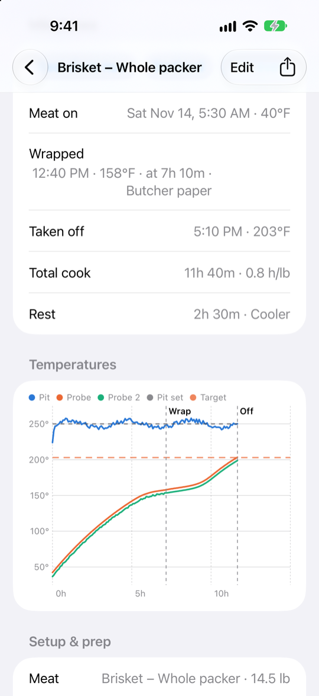
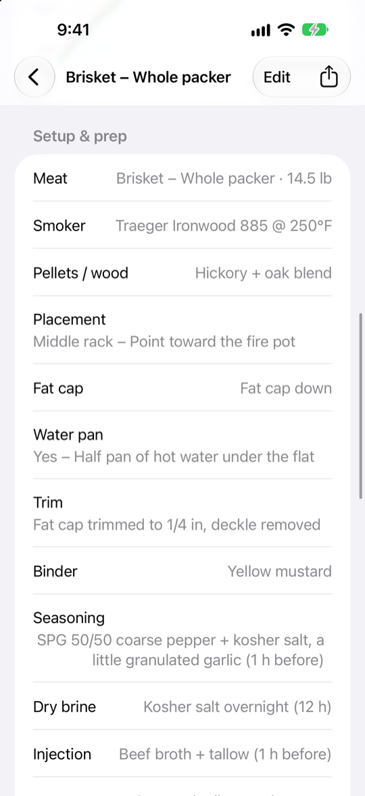
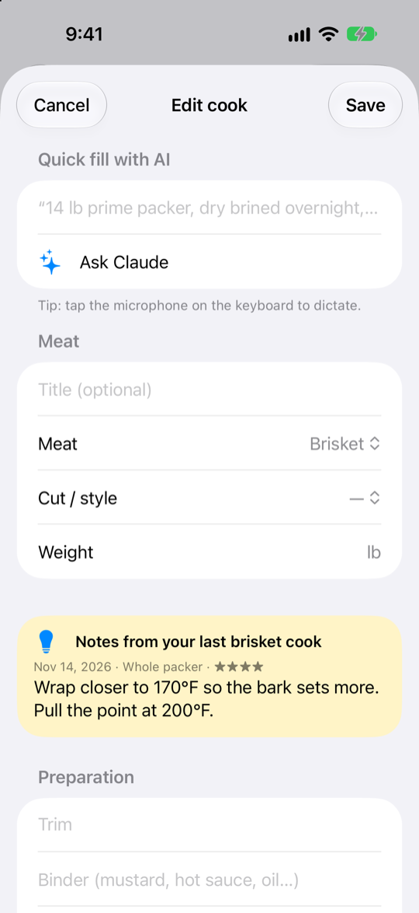
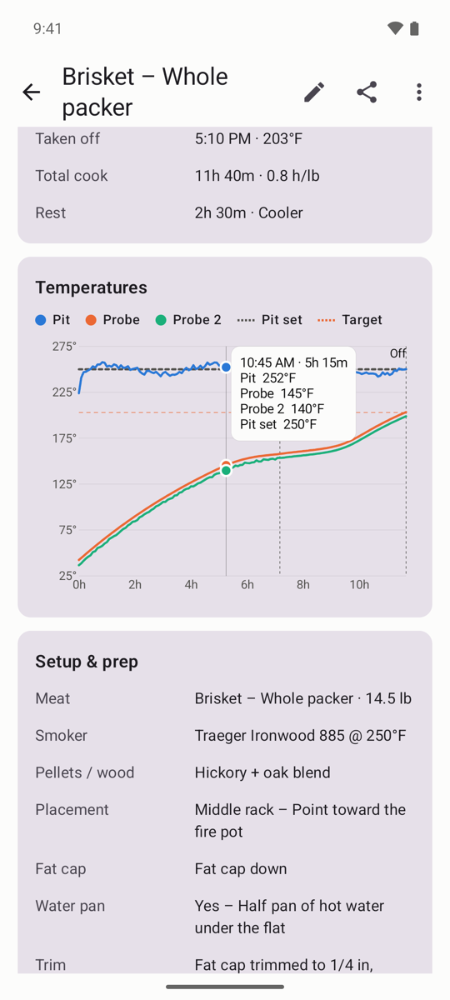
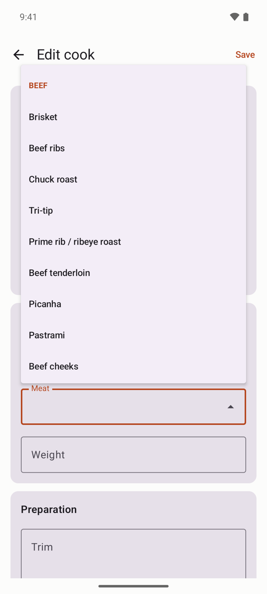
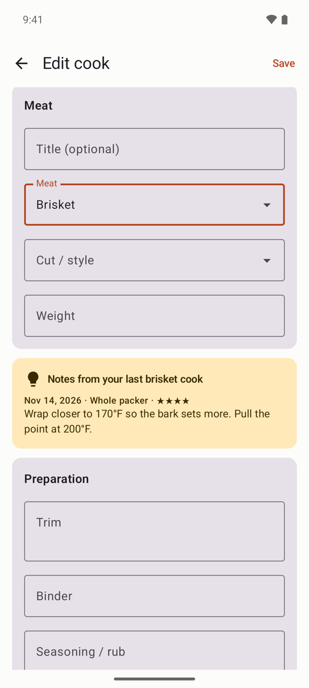

# SmokeLog

An app for logging smoked-meat cooks, for Android and iPhone (see [`ios/`](ios/README.md) for the iPhone version). It records how each cook was prepared and run, plots live Traeger temperatures, lets you share a cook, and uses Claude to fill the log from notes and to review your cooks.

## Screenshots

| | Cook page with live temperature chart | Setup & prep / meat picker | New cook with notes from last time |
|---|---|---|---|
| **iPhone** |  |  |  |
| **Android** |  |  |  |

*Sample data: a 14.5 lb brisket smoked at 250°F, with a stall around 155–165°F, wrapped in butcher paper, pulled at 203°F and rested in a cooler.*

## Install on your phone

**iPhone:** build and install with Xcode, see [ios/README.md](ios/README.md).

**Android** (8.0 or newer):

1. On your Android phone, open this repo's [**Releases**](../../releases/latest) page and download `SmokeLog.apk`.
2. Open the downloaded file. If Android asks, allow your browser (or Files app) to **install unknown apps**, then tap **Install**.
3. Open **SmokeLog** and allow notifications. They show recording status during a cook and alert you when a probe reaches its target.
4. Optional setup in **Settings** (gear icon):
   - **Traeger account:** enter your Traeger app email and password, then tap **Test connection**. Your grills should be listed.
   - **AI assistant:** keep **Claude app on this phone** (install [Claude](https://play.google.com/store/apps/details?id=com.anthropic.claude) from the Play Store), or switch to **API key** and enter an Anthropic API key.

> Google Play Protect may warn that the app is from an unknown developer, because it isn't on the Play Store. The APK is a debug build signed with a development key. To update, install the newer APK over the old one; your cooks are kept.

### Install from a computer (USB)

With [USB debugging](https://developer.android.com/studio/debug/dev-options) turned on and the phone plugged in:

```bash
adb install -r SmokeLog.apk
```

## What it tracks

| Area | Fields |
|---|---|
| Meat | meat chosen from a grouped list of common smoked meats (beef, pork, poultry, lamb & game, seafood, other) or typed in; cut/style from that meat's list or typed in; weight |
| Prep | trim, binder, seasoning (and how long before), dry brine and duration, wet brine and duration, injection (and how long before), notes |
| Smoker | smoker model, pellets/wood, target temp, placement (rack/zone and notes), fat cap up/down, water pan yes/no and notes |
| Cook | meat-on time and starting internal temp |
| Wrap | method (butcher paper, foil, foil boat, …), time, internal temp, elapsed time at wrap, notes (tallow, butter…) |
| Off & rest | time taken off, internal temp, total cook time (and h/lb), rest location (cooler, oven, …), rest end time or length, notes |
| Timeline | spritzes, temp changes, flips, stalls, custom notes |
| Result | 1–5 rating and notes |
| Photos | take pictures with the camera or add up to 10 from the photo library; captions; full-screen viewer; included when sharing |
| Notes for next cook | free text; shown at the top of your next cook of the same meat (up to the 3 most recent) |

On the cook screen, the **Wrapped now**, **Taken off now** and **Rest done now** buttons record the current time and the current probe temp.

## Organizing and search

- **Categories:** every cook is filed under Beef, Pork, Poultry, Lamb & game, Seafood or Other, worked out from the meat (including meats you type yourself). Change it under **Organize** when editing a cook.
- **Tags:** add your own labels, such as *Competition* or *Thanksgiving*. They travel with shared cooks.
- **Filter:** tap category and tag chips above the list. Several categories show cooks in any of them; several tags show cooks that have all of them.
- **Sort and group:** newest, oldest, highest rated, longest or by name; grouped by category, meat or month. Your choice is remembered.
- **Search:** looks through titles, meats, tags, seasoning, brines, wood, notes, timeline events, photo captions and AI debriefs, ignoring accents and capitals. Every word has to match, and each result shows where it matched.

## Traeger integration

- In **Settings**, enter your Traeger app (WiFIRE) email and password, then tap **Test connection**.
- On a cook, tap **Record from grill** and pick a grill. A foreground service subscribes to the grill's live MQTT feed and saves pit, set and probe temps every 60 s (you can change the interval). It keeps running when the phone is locked. If the grill goes quiet, the app asks it for an update every minute, and the line under the live numbers says what the connection is doing.
- **Up to four probes at once:** two wired (**Probe**, **Probe 2**) and two Bluetooth (**Bluetooth 1**, **Bluetooth 2**). Each probe has its own live tile and chart line, and its own notification when it reaches the target set on the grill.
- The chart shows pit, each probe, pit-set and probe-target lines on one °F axis, with markers for the wrap and off times. Touch and drag on the chart to see the values at any point.
- **Demo grill (simulated)** runs a simulated brisket cook (one simulated minute per second), so you can try the chart without a grill.
- Without a Traeger, use **Add reading…** to enter temperatures by hand.

> **Caveat:** Traeger has no official public API. `traeger/TraegerClient.kt` uses the same AWS Cognito, REST and IoT MQTT endpoints as the Traeger app and the community Home Assistant integration. Traeger could change these at any time. If the live feed breaks, `TraegerClient.kt` and `MqttWebSocket.kt` are the files to update. The live feed and Bluetooth probes were tested on a Timberline XL; two wired probes at once are covered by tests but not yet confirmed on a grill.

## Sharing

- **Share summary (text)** sends a readable recap of the cook (setup, prep, wrap, timings, timeline, result) through any messaging or email app.
- **Share full cook file** sends a `.smokelog.json` file that includes every temperature reading. When another SmokeLog user opens the file, the cook is imported with its full chart.

## AI assistant (Claude)

Choose how SmokeLog talks to Claude in **Settings → AI assistant**:

- **Claude app on this phone** (default, no API key): SmokeLog opens the Claude app with your notes or cook data. In Claude, pick **New session**, send, then long-press the reply → **Copy**, return to SmokeLog and tap **Paste Claude's reply**. Uses your Claude subscription. (The Claude app can't send answers back to other apps automatically, hence the copy/paste step.)
- **API key**: fully automatic using an Anthropic API key (default model `claude-opus-5-5`), billed separately.

Features:

- **Quick fill with AI** (edit screen): type or dictate notes in your own words (*"14 lb prime packer, dry brined overnight, on at 6 at 250 fat down, wrapped in pink paper with tallow at 165 around 1"*). Claude fills in the matching fields and adds timeline events and readings. Review the result, then tap Save.
- **AI pitmaster** (cook screen): a debrief based on your temperature log (stall length, pit stability, hours per pound, wrap timing), compared with your past cooks of the same meat and your "notes for next cook". You can also ask your own questions. A pasted Claude-app reply is saved with the cook.

Data only leaves the phone when you tap an AI button. Credentials are kept in `EncryptedSharedPreferences`.

## Build from source

Open the folder in Android Studio (Ladybug or newer) and run the `app` configuration, or from a terminal with JDK 17 and the Android SDK (API 35):

```bash
./gradlew assembleDebug
```

The APK is written to `app/build/outputs/apk/debug/app-debug.apk`. Run the tests with `./gradlew testDebugUnitTest`. Min SDK 26, target SDK 35.

## Feature requests

Have an idea or found a bug? [Open an issue](../../issues/new/choose) using the **Feature request** or **Bug report** template. Planned and requested features are tracked in [issues labelled `enhancement`](../../issues?q=is%3Aissue+label%3Aenhancement).

## Layout

```
app/src/main/java/com/smokelog/
  SmokeLogApp.kt            app container (DB, settings, Traeger, AI)
  data/                     Room entities + DAO, encrypted settings, formatting
  traeger/                  Traeger cloud client, MQTT live feed, foreground recorder service
  share/CookShare.kt        text summary, JSON export/import, share intents
  ai/AiAssistant.kt         Claude: notes → fields, cook analysis
  ui/                       Compose screens, temperature chart
```
